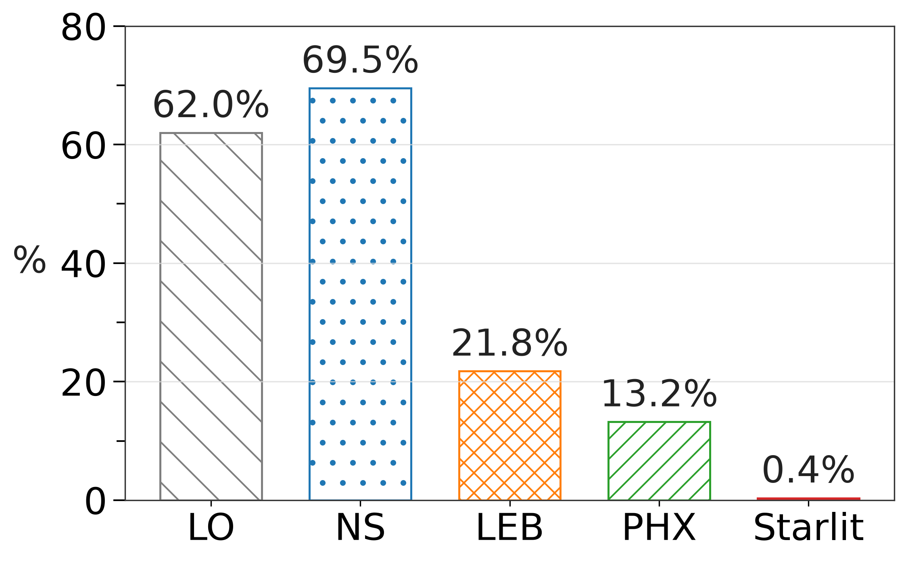
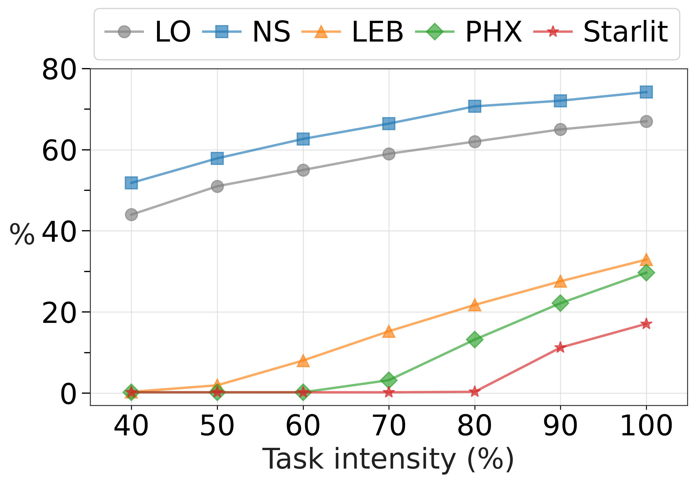
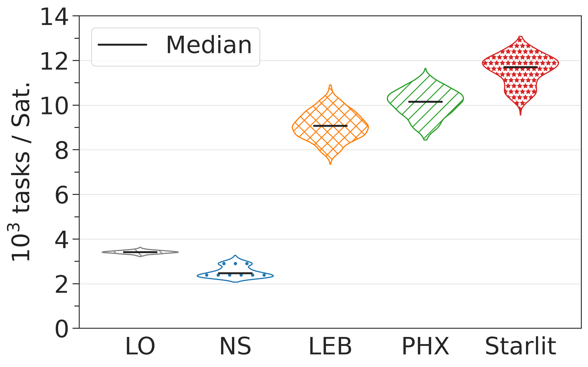
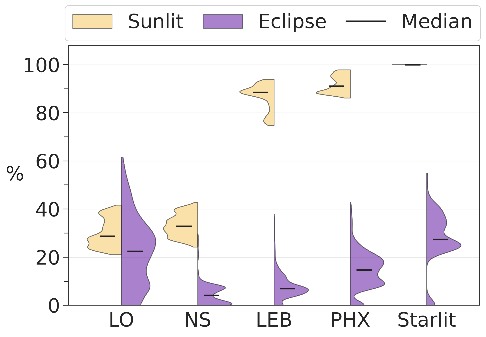
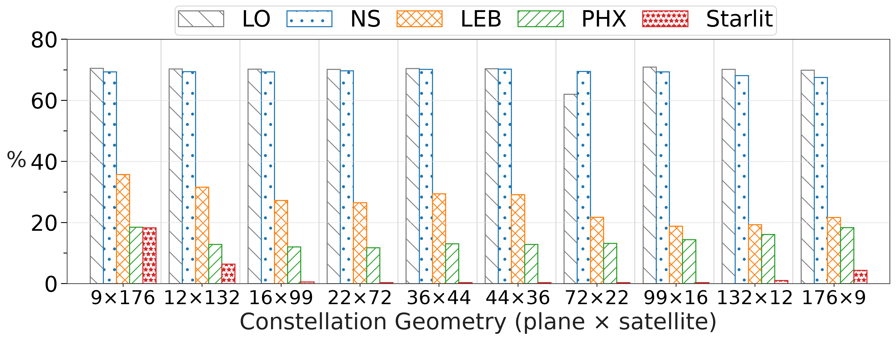
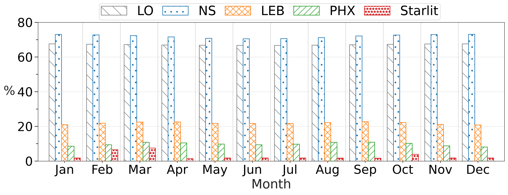

# Satmulator

Satmulator 是用於低軌衛星網路（LEO NTN）實驗的離散時間模擬器，主要研究在日照、蝕區與有限電池能量條件下，如何分配與轉送運算任務。

## 模擬器實驗目的

本專案用相同的星座、工作負載與能源條件，比較低軌衛星網路中的任務排程方法，並評估不同負載、月份與軌道面數量對電池安全、任務失敗率及能源消耗的影響。

## 五種排程方法

| 方法 | `scheduler.name` | 排程原則 |
| --- | --- | --- |
| Local Only（LO） | `local` | 任務只在來源衛星執行；若預測執行後會違反電池安全限制，則延後任務。 |
| Nearest Sunlit（NS） | `nearest-sunlit` | 來源衛星有日照時在本地執行；位於蝕區時，轉送至跳數最少且可到達的日照衛星，沒有可達目標時則留在本地。 |
| Greedy Energy（LEB） | `greedy-energy` | 在本地與鄰近日照衛星的可行方案中，優先選擇對蝕區電池影響最小的方案，再依完成時間、總能耗與跳數決定。 |
| PHOENIX（PHX） | `phoenix` | 日照來源優先本地執行；蝕區來源若期限允許則等待下一次日照，否則依軌道面負載與預測剩餘電量選擇日照衛星，最後才嘗試安全的本地執行。 |
| Starlit | `starlit` | 比較本地、低負載日照衛星、安全的蝕區衛星與延後執行，依負載、電池與期限成本選擇可行方案。 |

所有方法都使用相同的任務、路由、運算與電池模型；差異主要在任務放置、佇列順序與延後策略。無法在期限及電池限制內完成的任務會失敗。

## 前置準備

建議使用 Python 3.10 以上版本，並在專案根目錄建立虛擬環境：

```bash
python3 -m venv .venv
source .venv/bin/activate
python -m pip install -r requirements.txt
```

太陽位置由 Skyfield 讀取 JPL DE440s 星曆。`de440s.bsp` 不納入 Git，第一次執行前請在專案根目錄下載：

```bash
python -c "from skyfield.api import load; load('de440s.bsp')"
```

模擬設定會讀取 `data/demand/` 內的人口需求資料，因此執行指令時應保持目前工作目錄為專案根目錄。

## 執行方式

每次模擬都必須指定一份完整的 JSON 設定檔：

```bash
python minimal_orbit.py \
  --config configs/loading-ratio/r40/local-only.json
```

`configs/` 目前包含三類實驗：

- `configs/loading-ratio/`：比較不同任務負載比例。
- `configs/months/`：比較不同月份的日照條件。
- `configs/orbital-planes/`：比較不同軌道面數量。

設定檔決定模擬時間、星座、工作負載、排程方法、紀錄模式及輸出路徑；命令列不會覆寫個別設定。這些設定是完整實驗規模，執行時間與輸出容量可能很大，執行前應先確認設定內容。

模擬完成後，結果會寫入設定檔中 `output.path` 指定的目錄，主要包含：

- `run.json`：實際使用的設定、執行狀態與衛星清單。
- `states.jsonl`：各時間步的衛星狀態；可由設定關閉。
- `tasks.jsonl`：任務生命週期事件。
- `summary.json`：實驗摘要與主要評估指標。

### 播放衛星軌跡

互動式視覺化工具直接讀取模擬輸出的 `states.jsonl`：

```bash
python -m tools.visualizer output/log
```

視覺化工具提供以下重點功能：

- 以 3D 地球播放衛星軌跡，並呈現日照、蝕區與軌道面
- 選取衛星後顯示經緯度、軌道高度、日照、電量、地面新任務數，以及該
  time step 在本機完成、失敗、運算與排隊的任務資訊
- 右側圖表顯示所選衛星最近 120 個 time steps 的電量，以及日照與蝕區
  衛星的運算利用率分布

要播放的模擬設定必須保留完整時間步：

```json
"logging": {
  "task_events": "off",
  "state_steps": "full"
}
```

視覺化只讀取既有輸出，不會重新執行或修改模擬結果。

## 評估指標

電池安全門檻定義為：

```text
E_safe = battery.capacity_j × battery.min_safe_pct / 100
```

令 `N` 為衛星總數、`T` 為納入摘要的時間步數、`U_t` 為時間步 `t` 低於 `E_safe` 的衛星集合、`E_t` 為時間步 `t` 位於蝕區的衛星集合、`G` 為產生的任務數、`F` 為失敗的任務數。

| `summary.json` 欄位 | 定義 |
| --- | --- |
| `tasks.failure_ratio` | `F / G`；若沒有產生任務則為 0。模擬結束時仍 pending 的任務不算失敗。 |
| `battery_violations.avg_unsafe_ratio` | `(1 / T) × Σ(count(U_t) / N)`；每個時間步低於 `E_safe` 的全體衛星比例之時間平均。 |
| `battery_violations.avg_eclipse_unsafe_ratio` | `(1 / T) × Σ(count(U_t ∩ E_t) / count(E_t))`；每個時間步中，蝕區衛星低於 `E_safe` 的比例之時間平均。若該時間步沒有蝕區衛星，該步記為 0。 |
| `battery_violations.unique_breached_ratio` | `count(∪U_t) / N`；摘要期間曾低於 `E_safe` 的不同衛星比例。 |
| `battery_violations.unique_eclipse_breached_ratio` | `count(∪(U_t ∩ E_t)) / N`；摘要期間曾在蝕區低於 `E_safe` 的不同衛星比例，分母仍為全部衛星。 |
| `energy.eclipse.total_j` | 蝕區中的閒置能耗與任務能耗總和。 |
| `final_battery_j.minimum` | 摘要最後一個時間步的最低衛星電量。 |
| `final_battery_j.average` | 摘要最後一個時間步的平均衛星電量。 |

JSON 中的比例皆使用 `0` 到 `1`，繪圖時才乘以 100 顯示為百分比。若設定 `logging.summary_start_s` 與 `logging.summary_duration_s`，電池指標只統計該時間窗；任務指標則追蹤在該時間窗內產生的任務。未設定時使用完整模擬期間。

## 論文圖表

下列圖表皆由 `tools/` 內的程式產生。長條圖與折線圖讀取各實驗的 `summary.json`；violin plot另外需要完整的 `states.jsonl`。圖中的任務失敗率越低越好，黑色短線表示分布中位數。方法縮寫依序為 LO（local-only）、NS（nearest-sunlit）、LEB（greedy-energy）、PHX（phoenix）與 Starlit。

| 圖表 | 簡介 | 繪圖工具 |
| --- | --- | --- |
|  | 比較 80% 任務負載下五種排程方法的任務失敗率。 | `compare_task_outcomes.py` |
|  | 比較任務負載由 40% 增加至 100% 時，各方法的任務失敗率變化。 | `plot_final_loading_effects.py` |
|  | 顯示 80% 負載下，每顆衛星完成任務數的分布。 | `plot_loading_violin.py --plot total` |
|  | 分別顯示 80% 負載下，衛星處於日照與蝕區時的運算利用率分布。 | `plot_loading_violin.py --plot illumination-relative` |
|  | 固定 1,584 顆衛星，比較不同軌道面與每面衛星數量下的任務失敗率。 | `compare_grouped_task_outcomes.py` |
|  | 比較十二個月份三日模擬的中間日摘要，觀察各排程方法的任務失敗率。 | `compare_grouped_task_outcomes.py` |

請先完成對應實驗，再於專案根目錄執行以下指令。所有繪圖工具都會同時輸出 PNG 與 PDF。

```bash
# 80% 負載下的任務失敗率
python tools/compare_task_outcomes.py \
  output/final-loading-ratio/r80/local-only \
  output/final-loading-ratio/r80/nearest-sunlit \
  output/final-loading-ratio/r80/greedy-energy \
  output/final-loading-ratio/r80/phoenix \
  output/final-loading-ratio/r80/starlit \
  --out images/r80-task-outcomes

# 80% 負載下的每顆衛星完成任務數分布
python tools/plot_loading_violin.py \
  output/final-loading-ratio/r80 \
  --plot total \
  --out images/loading-violin

# 80% 負載下的日照與蝕區運算利用率分布
python tools/plot_loading_violin.py \
  output/final-loading-ratio/r80 \
  --plot illumination-relative \
  --out images/loading-illumination-violin

# 各負載比例的任務失敗率；另圖為每個時間步低於 E_safe 的衛星比例平均
# 同時產生兩張圖與摘要 CSV
python tools/plot_final_loading_effects.py \
  --base-dir output/final-loading-ratio \
  --out-dir images \
  --runs r40 r50 r60 r70 r80 r90 r100

# 不同軌道面配置的任務失敗率
python tools/compare_grouped_task_outcomes.py \
  --base-dir output/all-planes \
  --groups p9 p12 p16 p22 p36 p44 p72 p99 p132 p176 \
  --group-labels \
    '9×176' '12×132' '16×99' '22×72' '36×44' \
    '44×36' '72×22' '99×16' '132×12' '176×9' \
  --xlabel 'Constellation Geometry (plane $\times$ satellite)' \
  --out images/all-planes-task-failure-rate

# 十二個月份的任務失敗率
python tools/compare_grouped_task_outcomes.py \
  --base-dir output/all-months-3day \
  --groups m01 m02 m03 m04 m05 m06 m07 m08 m09 m10 m11 m12 \
  --group-labels Jan Feb Mar Apr May Jun Jul Aug Sep Oct Nov Dec \
  --xlabel Month \
  --out images/all-months-3day-task-failure-rate
```

## 專案結構

### 主要入口與資料

| 路徑 | 功能 |
| --- | --- |
| `minimal_orbit.py` | 模擬器命令列入口。 |
| `requirements.txt` | 模擬與繪圖所需套件。 |
| `requirements-worldpop.txt` | 轉換 WorldPop 原始資料所需的額外套件。 |
| `configs/` | 各組實驗的完整 JSON 設定。 |
| `data/` | 人口需求點與 WorldPop 原始資料。 |
| `tests/` | 模擬器核心與繪圖輔助函式的測試。 |
| `output/` | 模擬紀錄與圖表的預設輸出位置。 |

### 模擬器核心

| 檔案 | 功能 |
| --- | --- |
| `simulator/__init__.py` | 標記 `simulator` Python 套件。 |
| `simulator/cli.py` | 解析命令列參數並啟動模擬。 |
| `simulator/config.py` | 讀取、驗證及建立模擬設定。 |
| `simulator/models.py` | 定義設定、任務、路徑及衛星狀態資料。 |
| `simulator/runtime.py` | 保存模擬期間會變動的衛星與環境狀態。 |
| `simulator/runner.py` | 組織完整模擬流程並輸出進度與摘要。 |
| `simulator/orbit.py` | 推進軌道、日照、電池與任務執行狀態。 |
| `simulator/geometry.py` | 計算軌道、向量、日照及幾何關係。 |
| `simulator/battery.py` | 更新電池能量並判斷安全門檻。 |
| `simulator/workload.py` | 載入需求點並產生人口加權任務。 |
| `simulator/isl.py` | 建立星間鏈路圖並計算路由。 |
| `simulator/route_cost.py` | 估算路由時間、運算量與能源成本。 |
| `simulator/scheduler.py` | 實作各種任務排程與能源限制。 |
| `simulator/runlog.py` | 寫入及讀取 JSON/JSONL 實驗紀錄。 |
| `simulator/task_projection.py` | 將任務事件還原為完整生命週期。 |
| `simulator/plot_styles.py` | 統一各排程方法的圖表樣式與名稱。 |
| `simulator/constants.py` | 保存模擬使用的物理常數。 |

### 實驗與繪圖工具

| 檔案 | 功能 |
| --- | --- |
| `tools/run_final_loading_ratio_batch.py` | 批次執行負載比例實驗。 |
| `tools/compare_task_outcomes.py` | 比較單組實驗的任務失敗率。 |
| `tools/compare_grouped_task_outcomes.py` | 比較多組實驗與多種排程方法。 |
| `tools/compare_eclipse_dod_cdf.py` | 繪製蝕區電池放電深度 CDF。 |
| `tools/plot_loading_violin.py` | 繪製衛星負載與日照利用率小提琴圖。 |
| `tools/plot_final_loading_effects.py` | 繪製負載比例對電池與任務結果的影響。 |
| `tools/plot_output.py` | 統一圖表輸出為 PNG 與 PDF。 |
| `tools/visualizer.py` | 互動播放 `states.jsonl` 中的衛星軌跡。 |
| `tools/worldpop_to_demand_points.py` | 將 WorldPop 柵格資料彙整成需求點 CSV。 |
